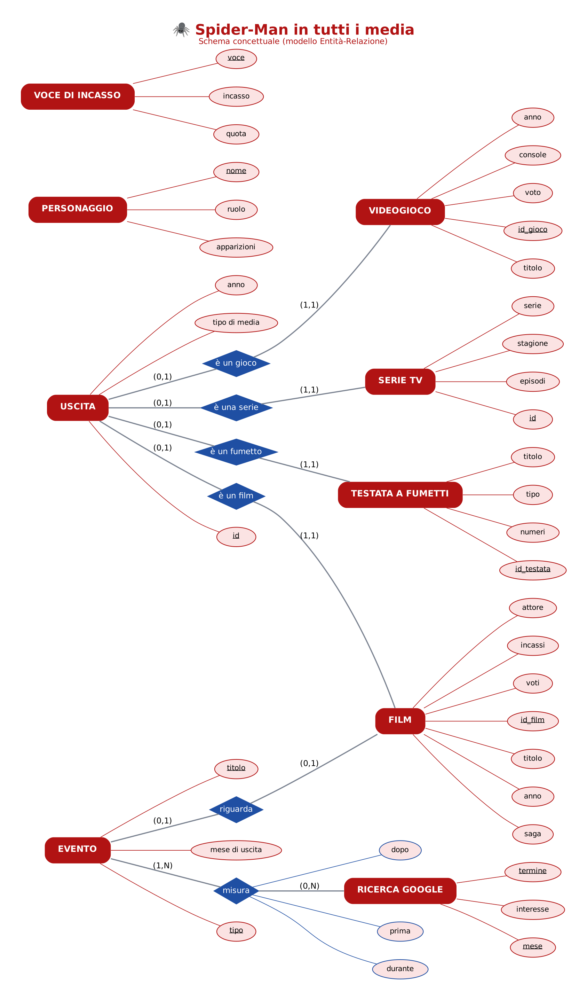
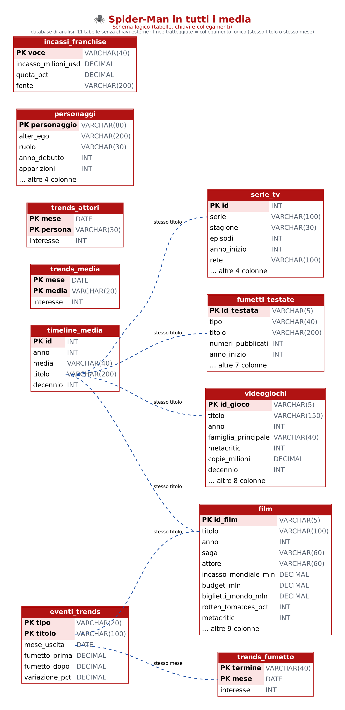

# 🕷️ Spider-Man in tutti i media – Progetto Data Analyst

Progetto personale di **Francesco Autorino**.

🛠️ Strumenti: **Excel · SQL · Python · Power BI**

📅 Dati raccolti il 25 ottobre 2026.

---

## 🧭 1. La domanda del progetto

**Come è cresciuto Spider-Man passando dai fumetti a film, serie TV e videogiochi?**

La divido in 5 domande più piccole:

1️⃣ Quale media ha fatto guadagnare di più?

2️⃣ Come sono andati i film? Quale saga funziona meglio?

3️⃣ Film e videogiochi fanno cercare il fumetto?

4️⃣ Come è cambiato Spider-Man nei videogiochi?

5️⃣ Chi sono i personaggi più importanti del suo mondo?

📝 Le risposte sono in **03Python/02_CONCLUSIONI.md**.

---

## 🔄 2. Il percorso dei dati

```
INTERNET          01_raccolta.py      02_pulizia.py        ANALISI
Wikipedia ──┐                                         ┌──► 📗 Excel
Google ─────┼──►  ❌ 14 file grezzi  ──►  ✅ 11 tabelle ──┼──► 🗄️ SQL
FiveThirty- │     (1GrezziNonPuliti)  (2Puliti)       ├──► 🐍 Python
Eight ──────┘                                          └──► 📊 Power BI
```

👉 In parole semplici:

1. Lo script **01** scarica i dati da internet.
2. Lo script **02** li pulisce e li ordina in tabelle.
3. Excel, SQL, Python e Power BI leggono **le stesse tabelle pulite**.

---

## 📁 3. I file in questo repository

| File | A cosa serve |
|---|---|
| `README.md` | Questo file |
| `DESCRIZIONE_GITHUB.md` | Nome, descrizione e topics del repository |
| `00_LEGGIMI.md` (in ogni cartella) | Una spiegazione corta di quella cartella |

### 📂 01Excel

| File | A cosa serve |
|---|---|
| `01_SpiderMan_Analisi.xlsx` | 📗 Il file Excel finito (135 formule, zero errori) |

**I fogli del file Excel:**

| Foglio | Cosa c'è |
|---|---|
| LEGGIMI | Guida, legenda colori, fonti, limiti |
| Riepilogo | 11 indicatori principali, confronto tra saghe, giochi per decennio, ricerche intorno alle uscite (tutto con formule) |
| Film | Tabella dei film + 4 colonne calcolate (moltiplicatore, profitto, quota estero, prezzo medio del biglietto) |
| Videogiochi | Tabella dei giochi, voti colorati + colonna "giocato" da compilare (SI/NO) |
| Serie_TV, Fumetti, Personaggi | Tabelle complete con filtri |
| Incassi | Voci di incasso, totale con formula, grafico |
| Prima_Dopo | Ricerche del fumetto intorno alle uscite, con picco e variazione calcolati |
| Controllo_Qualita | Valori mancanti, doppioni, controllo che le quote facciano 100 |

🎨 Colonne **arancioni** = formule · celle **gialle con testo blu** = da compilare a mano.

---

### 📂 02SQL

| File | A cosa serve |
|---|---|
| `01_schema_concettuale.png` | 🧩 Lo schema concettuale (modello Entità-Relazione) |
| `02_schema_logico.png` | 🗂️ Lo schema logico: tabelle, chiavi PK/FK e collegamenti |
| `03_crea_database.sql` | 🏗️ Crea il database `SpiderMan` e le 11 tabelle in MySQL |
| `04_query_analisi.sql` | 🔍 21 query divise per domanda (funzionano in MySQL e SQLite) |

**Le tecniche SQL usate:** GROUP BY, HAVING, CASE WHEN, CTE (WITH), funzioni finestra (RANK, ROW_NUMBER, LAG), UNION ALL, viste.


🧩 **Schema concettuale**



🗂️ **Schema logico**



---

### 📂 03Python

| File | A cosa serve |
|---|---|
| `01_analisi_spiderman.ipynb` | 📓 Il notebook con tutte le analisi, già eseguito (lo apri con Jupyter) |
| `02_CONCLUSIONI.md` | 📝 Le risposte alle 5 domande, con i numeri |

**I 13 grafici:**

| N° | Grafico | Domanda |
|---|---|---|
| 01 | Incassi del franchise per voce | 1 |
| 02 | Incasso mondiale di ogni film | 2 |
| 03 | Critica contro incassi | 2 |
| 04 | Biglietti venduti per film | 2 |
| 05 | Ricerche Google per tipo di media | 3 |
| 06 | Ricerche del fumetto con le date di uscita | 3 |
| 07 | Ricerche del fumetto prima, durante e dopo ogni film | 3 |
| 08 | Ricerche dei tre attori e di Miles Morales | 2-3 |
| 09 | Voti Metacritic dei videogiochi nel tempo | 4 |
| 10 | Videogiochi per decennio e console | 4 |
| 11 | Episodi delle serie TV | – |
| 12 | Nuove testate a fumetti per decennio | – |
| 13 | I 15 personaggi con più apparizioni | 5 |

**I test statistici:** correlazione di Spearman (critica e incassi), test di Wilcoxon (ricerche prima e dopo i film).

---

### 📂 04PowerBi

| File | A cosa serve |
|---|---|
| `01_SpiderManDashboard.zip` | ⭐ **La dashboard**: estrai lo zip e apri `SpiderMan_Dashboard.pbip` con Power BI Desktop |
| `02_SpiderMan_Dashboard.pdf` | Il PDF della dashboard finale (7 pagine) |
| `03_misure_DAX.txt` | Le misure DAX spiegate, da copiare se costruisci a mano |

**Le 7 pagine della dashboard:**

| Pagina | Cosa mostra |
|---|---|
| 0 La storia | La storia dell'Uomo Ragno: creatori, editoria, fumetti, cartoni, film e videogiochi |
| 1 Panoramica | 6 numeri chiave, incassi per voce, uscite per decennio e tipo di media |
| 2 I film | Incasso di ogni film, incasso medio per saga, critica contro incassi, tabella di dettaglio, filtro per saga |
| 3 Ricerche Google | Ricerche per tipo di media, picco del fumetto alle uscite, prima/durante/dopo ogni film, attori |
| 4 Videogiochi | Voti Metacritic nel tempo, giochi per decennio e console, i giochi migliori |
| 5 Fumetti, TV, personaggi | Personaggi con più apparizioni, episodi per serie, testate per decennio e tipo |
| 6 Conclusioni | Le risposte alle 5 domande e i limiti |

---

## 📦 4. Dati e script

📌 Qui ci sono solo i **risultati**: analisi, query, notebook, file Excel e dashboard.

📥 I dati si possono riscaricare dalla fonte (link più sotto).

🐍 Gli script Python di raccolta e pulizia dei dati sono disponibili su richiesta.

---

## 🔗 5. Da dove arrivano i dati (link)

| Fonte | Cosa ho preso | Link |
|---|---|---|
| Wikipedia – Spider-Man in film | Incassi, budget, biglietti, voti, attori dei 12 film | https://en.wikipedia.org/wiki/Spider-Man_in_film |
| Wikipedia – Spider-Man in television | Serie TV, stagioni, episodi, reti | https://en.wikipedia.org/wiki/Spider-Man_in_television |
| Wikipedia – List of Spider-Man video games | I 41 videogiochi: anno, piattaforme, sviluppatore | https://en.wikipedia.org/wiki/List_of_Spider-Man_video_games |
| Wikipedia – pagina di ogni gioco | Voto Metacritic e genere | (link nella colonna `articolo_wikipedia` di `wiki_videogiochi_dettagli.csv`) |
| Wikipedia – giochi più venduti per console | Copie vendute di 5 giochi | https://en.wikipedia.org/wiki/List_of_best-selling_PlayStation_video_games · https://en.wikipedia.org/wiki/List_of_best-selling_PlayStation_2_video_games · https://en.wikipedia.org/wiki/List_of_best-selling_PlayStation_4_video_games · https://en.wikipedia.org/wiki/List_of_best-selling_PlayStation_5_video_games |
| Wikipedia – List of Spider-Man titles | Testate a fumetti, volumi, numeri, anni | https://en.wikipedia.org/wiki/List_of_Spider-Man_titles |
| Wikipedia – List of Spider-Man enemies | I nemici e il loro debutto | https://en.wikipedia.org/wiki/List_of_Spider-Man_enemies |
| Wikipedia – List of highest-grossing media franchises | Incasso totale del franchise per voce | https://en.wikipedia.org/wiki/List_of_highest-grossing_media_franchises |
| Google Trends | Ricerche mese per mese dal 2004 | https://trends.google.com/trends/explore?date=all&q=Spider-Man%20comic |
| FiveThirtyEight (GitHub) | Personaggi Marvel e numero di apparizioni | https://github.com/fivethirtyeight/data/tree/master/comic-characters |

📅 Tutti i dati sono stati raccolti il **25 ottobre 2026**: le pagine Wikipedia possono cambiare nel tempo.

---

## 🪜 6. Tutti i passaggi fatti, in ordine

1️⃣ **Domanda**: ho scelto la domanda principale e le 5 domande più piccole.

2️⃣ **Fattibilità**: ho controllato che per ogni domanda esistessero dati pubblici e gratuiti.

3️⃣ **Raccolta** (`01_raccolta.py`): ho scaricato 14 file grezzi da Wikipedia, Google Trends e FiveThirtyEight.

4️⃣ **Pulizia** (`02_pulizia.py`):
   - trasformato testi come "$825,820,266" in numeri (825,8 milioni);
   - separato film e serie con lo stesso titolo aggiungendo l'anno;
   - separato i generi dei giochi attaccati;
   - tenuto solo lo sviluppatore principale;
   - sommato i numeri dei fumetti dagli intervalli "#1–700";
   - unito i nemici di Wikipedia con le apparizioni di FiveThirtyEight;
   - creato 11 tabelle pulite.

5️⃣ **Excel** (`crea_excel.py`): 10 fogli con formule, menu a tendina e foglio di controllo qualità.

6️⃣ **SQL** (`02_carica_dati.py` + `04_query_analisi.sql`): database con 11 tabelle e 21 query di analisi.

7️⃣ **Python** (notebook): 13 grafici e un test statistico (Wilcoxon) sull'effetto dei film sulle ricerche del fumetto.

8️⃣ **Power BI**: dashboard di 7 pagine con tema rosso e blu, sfondi disegnati da zero, pagina "La storia" e immagini inserite a mano.

9️⃣ **Conclusioni**: risposte alle 5 domande in `03Python/02_CONCLUSIONI.md` e PDF della dashboard.

---

## ⚠️ 7. Limiti dei dati

📌 Le copie vendute sono note solo per **5 videogiochi**.

📌 Le vendite dei singoli fumetti **non sono pubbliche**.

📌 Google Trends misura le **ricerche**, non le vendite.

📌 *Brand New Day* (2026) è appena uscito: incassi e biglietti possono ancora crescere.

📌 I personaggi sono aggiornati al **2014** (FiveThirtyEight).

📌 I numeri dei fumetti sono contati dagli intervalli scritti su Wikipedia (ristampe comprese).
